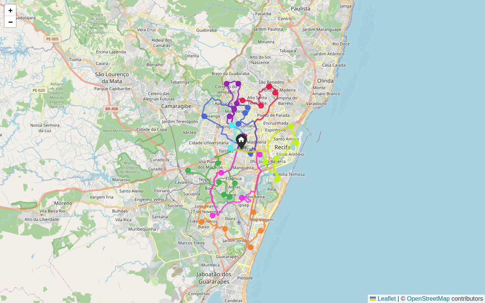

# Memetic CVRP — CVRPLIB Benchmarks & Supply Distribution Across UBS/USF Health Units in Recife/PE

Computational Intelligence course project applying **Evolutionary Computation** (Pure Genetic Algorithm and Memetic Genetic Algorithm with intra-route `2-opt` local search) to the **Capacitated Vehicle Routing Problem (CVRP)**, validated on classical CVRPLIB benchmark instances and a real-world geographic scenario for distributing medical supplies to Primary Health Units (UBSs/USFs) in Recife/PE.

## Project Structure

```text
cvrp-recife/
├── data/
│   ├── cvrplib/          # Classical instances (.vrp): A-n32-k5, A-n45-k6, A-n60-k9, A-n80-k10
│   └── recife_ubs/       # Static dataset of 40 UBSs/USFs + depot (JSON + road distance matrix .npy)
├── scripts/
│   └── prepare_recife_data.py  # Consolidation of Recife Open Data + OSRM/Haversine matrix
├── src/
│   ├── data/
│   │   ├── models.py           # CVRPInstance dataclass and integrity validations
│   │   ├── cvrplib_loader.py   # EUC_2D parser for CVRPLIB .vrp files
│   │   └── recife_loader.py    # Offline loader for Recife ('road' and 'haversine' modes)
│   ├── solver/
│   │   ├── decoder.py          # Giant Tour decoder with greedy capacity-constrained Split
│   │   ├── greedy.py           # Deterministic baseline (capacitated Nearest Neighbor)
│   │   ├── operators.py        # Tournament, elitism, OX/PMX crossovers, and Swap/Inversion mutations
│   │   ├── local_search.py     # Intra-route 2-opt local search (symmetric and asymmetric)
│   │   └── genetic.py          # Pure GA and Lamarckian Memetic GA
│   └── experiments/
│       ├── runner.py           # Runner for Phase 1 (ablation) and Phase 2 (30-seed comparison)
│       ├── stats.py            # Aggregation, gap %, and Wilcoxon / Mann-Whitney tests
│       ├── plots.py            # Convergence curves and comparative boxplots (.png)
│       └── map_recife.py       # Interactive Folium map of routes in Recife (.html)
├── tests/                      # Unit tests and smoke tests suite (pytest)
└── results/                    # Raw/summary CSVs, PNG charts, and recife_map.html
```

## Installation

Requires Python 3.10+.

```bash
python -m venv .venv
source .venv/bin/activate
pip install -r requirements.txt
```

## Running

### 1. Unit tests and smoke tests

```bash
pytest
```

### 2. Optional Recife/PE dataset preparation (already versioned in `data/recife_ubs/`)

The static dataset consolidates 40 primary care units (**UBS** and **USF** — *Unidades Básicas de Saúde* and *Unidades de Saúde da Família*) from Recife Open Data along with the central depot (`CAF Recife`), estimating unit replenishment demands from municipal pharmacy stockout records (`medicamentos-por-unidade-de-saude.csv`, counting `quantidade = 0` items per unit and min-max scaling into `[10, 40]` for `capacity = 100`).

```bash
python scripts/prepare_recife_data.py
```

Optional CLI flags: `--output-dir`, `--d-min`, `--d-max`, `--capacity`, `--stock-csv`.

### 3. Full experimental suite (Phase 1 + Phase 2 + Plots + Recife Map)

```bash
python -m src.experiments.runner
```

Optional CLI parameters available (`--phase1-seeds`, `--phase2-seeds`, `--pop-size`, `--generations`, `--ls-rate`, `--output-dir`).

Results are saved in `results/`:
- `phase1_ablation.csv`, `phase1_summary.csv`
- `phase2_results.csv`, `phase2_summary.csv`, `phase2_stats_tests.csv`
- `phase2_histories.json`, `best_solutions.json`
- `convergence_*.png`, `boxplot_*.png`
- `recife_map.html`

## Output Format & Node Index Mapping (`best_solutions.json`)

[`results/best_solutions.json`](results/best_solutions.json) stores the best route plans per instance and solver (`Greedy`, `Pure_GA`, `Memetic_GA`):

- **Best-of-seeds selection:** For `Pure_GA` and `Memetic_GA`, the saved entry is the single run with the lowest `distance` across all Phase 2 seeds (not an average).
- **Route representation (`routes`):** A `list[list[int]]` where each inner list is one vehicle's ordered sequence of customer visits (`len(routes) == num_vehicles`).
- **Implicit depot (`0`):** The depot index (`0`) is omitted from every inner list; each route implicitly starts and ends at the depot (`0 -> r[0] -> ... -> r[-1] -> 0`).
- **0-based node index mapping:**
  - **Recife (`Recife-UBS-40-road`, `Recife-UBS-40-haversine`):** Indices `0..40` match the 0-based array position in `"nodes"` inside [`data/recife_ubs/recife_ubs.json`](data/recife_ubs/recife_ubs.json) (`0` is `DEPOT-CAF`; `1..40` are the 40 UBS/USF units).
  - **CVRPLIB (`A-n32-k5`, `A-n45-k6`, `A-n60-k9`, `A-n80-k10`):** `.vrp` files use 1-based IDs in `NODE_COORD_SECTION`; [`load_cvrplib`](src/data/cvrplib_loader.py) sorts those IDs and reindexes them to 0-based (`idx = node_id - 1`, so `.vrp` node `1` becomes `0`, node `2` becomes `1`, etc.).
- **Distance units & symmetry:** CVRPLIB distances use TSPLIB `EUC_2D` nearest-integer rounding (`floor(d + 0.5)`). Recife distances are in kilometers (`km`), using geodesic Haversine distances (`Recife-UBS-40-haversine`) or a precomputed OSRM driving matrix (`Recife-UBS-40-road`, which may be asymmetric due to one-way streets).

## Recife Routes Map

Click the map preview below to open the interactive Folium map ([`results/recife_map.html`](results/recife_map.html)) in your browser:

[](https://lucasmacieel.github.io/cvrp-recife/results/recife_map.html)

> [Open interactive map](https://lucasmacieel.github.io/cvrp-recife/results/recife_map.html) · [View source HTML](results/recife_map.html)
